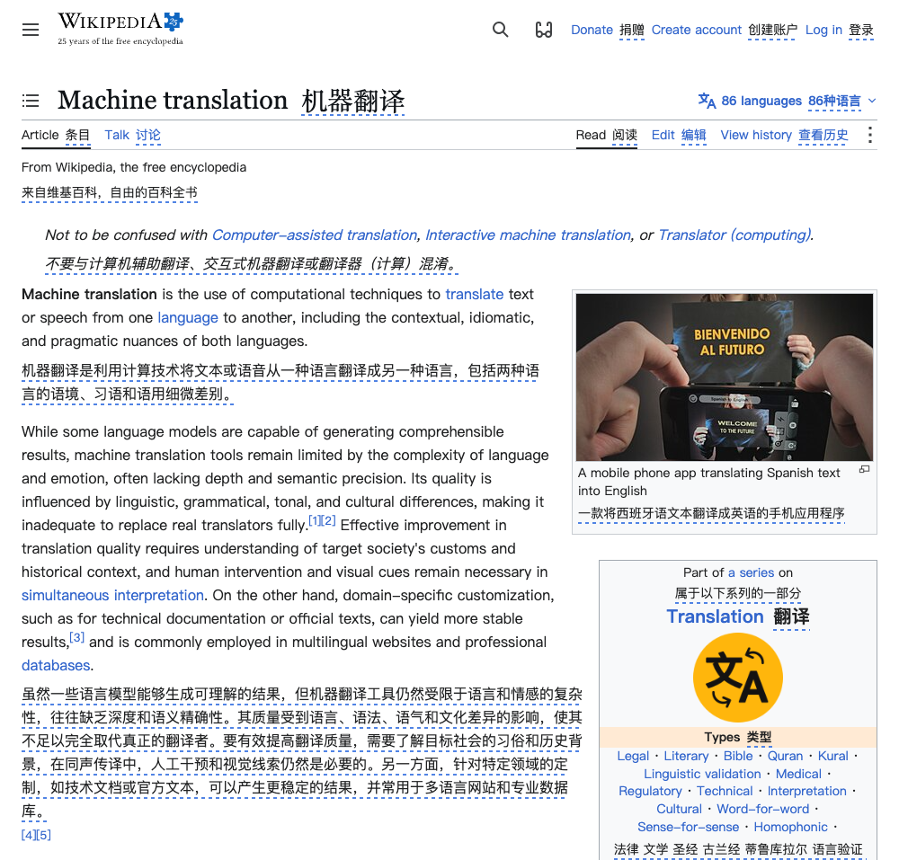
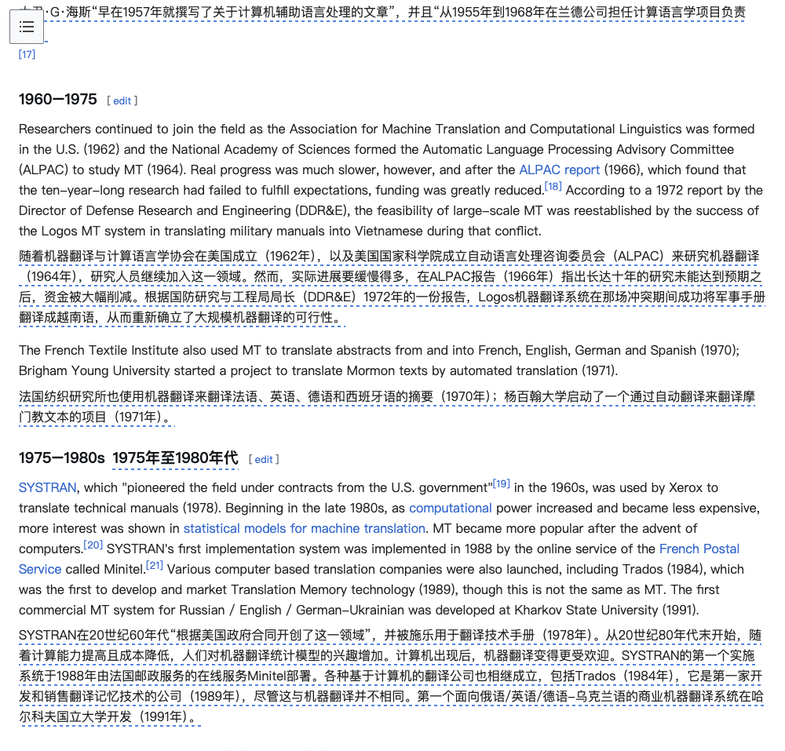
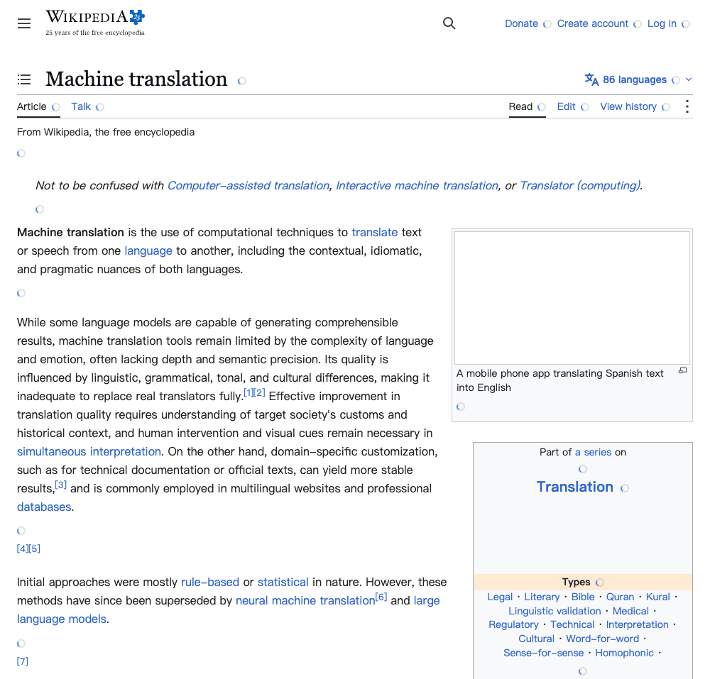
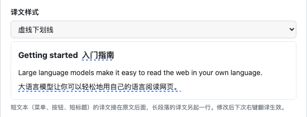

# translate-by-ai

一个 Chrome 插件：在网页上右键「用 AI 翻译」，调用**你自己配置的大模型**（默认 OpenRouter 上的 `deepseek/deepseek-v4.1-flash`），译文**追加在原文下方**，不替换原文。

## 效果

整页翻译（Wikipedia）：菜单、标签页、标题这类短文本的译文接在原文后面，长段落的译文另起一行，用虚线下划线和原文区分。



正文部分：



翻译中，每段先显示一个小圆圈，译文流式出现：



设置页可以切换译文样式（虚线下划线 / 弱化 / 无样式），带实时预览：



## 功能

- **划词翻译**：选中文字 → 右键「用 AI 翻译「…」」→ 译文出现在选区所在段落的下方。
- **整页双语翻译**：在页面空白处右键「用 AI 翻译此页面」→ 每个段落下方插入译文；**再点一次恢复原文**。
  - 段落滚动到视口附近才翻译，长页面不会一次性消耗大量 token。
  - 页面后续动态加载的内容也会被翻译。
  - 跳过 `<pre>`、`<code>`、输入框、`translate="no"` / `.notranslate`，以及已经是目标语言的段落。
- **同一页面是一个翻译会话**，术语和指代前后一致：
  - 同时进入视口的段落编号后合成一批、一次请求翻译，一屏内容互为上下文（菜单、标题这类短文本也能翻对）。
  - 批次依次发送，每批带上本页最近几轮的原文和译文（约 4000 字符），以及页面标题和域名；划词翻译也共用这个会话。
  - 恢复原文或刷新页面时会话清空。
- 译文显示：
  - 短文本（菜单、按钮、标签、短标题）的译文接在原文同一行后面，不会把导航栏、标签页撑高；长段落的译文另起一行。
  - 字体、颜色、对齐都继承原文，默认用蓝色虚线下划线区分译文；设置页可改为「弱化（半透明）」或「无样式」，带实时预览。
  - 段落里用 `<br>` 分行的内容逐行翻译，译文紧跟对应的行。
  - 加载中显示一个小圆圈；失败时只在较长的段落下显示错误（点击重试），短文本失败不打扰。
  - 个别网站的特殊规则（目前是 Wikipedia：不翻译 [编辑] 链接、引用角标、侧栏目录），见 `apps/extension/src/content/dom.ts` 的 `SITE_RULES`。
- 译文流式显示；模型偶尔漏掉某一段时会自动补翻。请求连接失败会自动重试一次，卡住超时会报错，不会堵住后面的翻译。
- 支持任意 **OpenAI 兼容接口**（OpenRouter、DeepSeek 官方、本地 Ollama 等）。API Key 只保存在本机 `chrome.storage.local`，请求由扩展后台发出，网页拿不到。

## 目录结构（pnpm monorepo）

```
packages/core        与浏览器无关的翻译核心：OpenAI 兼容流式客户端、SSE 解析、prompt、服务商预设、语言列表
apps/extension       Chrome MV3 插件
  src/background     service worker：右键菜单、按需注入脚本、调用模型（流式经 Port 回传）
  src/content        注入网页的脚本：切分段落、插入译文
  src/options        设置页
  static             manifest.json、options.html/css（构建时原样拷贝）
```

## 安装

需要 Chrome 120 及以上。

### 从 Release 安装（推荐）

1. 在 [Releases](https://github.com/Excalibur0w0/translate-by-ai/releases/latest) 下载 `translate-by-ai-v*.zip`，解压到一个固定的位置（Chrome 会一直从这个文件夹加载插件，之后不要删除或移动它）。
2. 打开 `chrome://extensions`，开启右上角的「开发者模式」。
3. 点击「加载已解压的扩展程序」，选择解压出来的文件夹（里面直接就是 `manifest.json`）。

升级时下载新版本，解压覆盖原来的文件夹，再到 `chrome://extensions` 点这个插件的刷新按钮。

### 从源码构建

```bash
pnpm install
pnpm build          # 产物在 apps/extension/dist
```

然后按上面第 2、3 步加载 `apps/extension/dist`。

## 开始使用

1. 点击工具栏上的「AI 翻译」图标打开设置页，填入 OpenRouter API Key（[获取](https://openrouter.ai/keys)），点「测试翻译」确认可用后保存。
2. 在任意网页右键即可使用：选中文字时是「用 AI 翻译「…」」，在页面空白处是「用 AI 翻译此页面」。

> 第一次右键时如果还没配置 Key，会自动打开设置页。

## 配置说明

| 项 | 说明 |
| --- | --- |
| 服务商 | 预设会自动填好 API 地址、模型和额外参数；选「自定义」可接入任意 OpenAI 兼容接口 |
| API 地址 | base URL，实际请求 `{API 地址}/chat/completions`；也可以直接填完整的 `.../chat/completions` |
| 模型 | 例如 `deepseek/deepseek-v4.1-flash` |
| 额外请求参数 | 合并进请求体的 JSON。OpenRouter 预设为 `{"reasoning":{"enabled":false}}`——该模型默认开启推理，翻译用不上，关掉更快更省 |

使用 OpenRouter 以外的域名时，保存时浏览器会请求访问该域名的权限（`optional_host_permissions`），同意即可。

## 开发

```bash
pnpm dev            # esbuild watch，改完代码后在 chrome://extensions 点刷新
pnpm test           # core 的单元测试（vitest）
pnpm typecheck
```

- 新增服务商预设：编辑 `packages/core/src/providers.ts`。
- 新增目标语言：编辑 `packages/core/src/languages.ts`。
- 译文样式、换行规则、网站特殊规则：`apps/extension/src/content/dom.ts`（`CSS`、`layoutFor`、`SITE_RULES`）。

### 发布新版本

1. 修改 `apps/extension/static/manifest.json` 里的 `version`（打包和 Release 都以它为准）。
2. 打包：`pnpm package`，生成 `release/translate-by-ai-v<版本>.zip`。
3. 提交并推送后创建 Release：

   ```bash
   gh release create v<版本> release/translate-by-ai-v<版本>.zip --title "v<版本>" --notes "更新说明"
   ```

## 权限说明

- `contextMenus`：右键菜单。
- `activeTab` + `scripting`：只有在你点击右键菜单时才向当前页注入脚本，平时不读取任何网页。
- `storage`：保存设置。
- `https://openrouter.ai/*`：调用 OpenRouter；其它服务商的域名按需申请。
